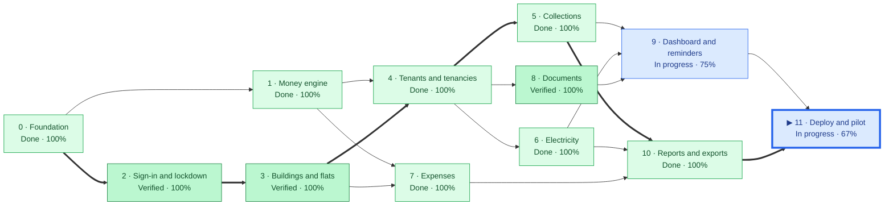

# Family Property Manager — build tracker

> Generated from `tracker.json` by `npm run tracker`. **Do not edit this file by hand.**
> Visual version: [tracker.html](tracker.html) · History: [CHANGELOG.md](CHANGELOG.md)

**Last updated:** 2026-11-23 12:34 IST  
**Overall progress:** `███████████████████░` **97%** (89 of 92 tasks done)  
**Open blockers:** 4

## ▶ Where we are now

**Phase 11 · Deploy and pilot** — In progress, 67% done

**Current step:** Owner reviews the app and lists changes; publish only when asked.

**Comment:** All phases built; Google Drive documents verified live.

## Next steps

1. Owner: review the app and list any changes.
2. Owner: commit Phases 5 onwards.
3. Owner: upgrade to Blaze, then deploy the 9 AM push function and add the web-push key (B3, B11).
4. Publish to Firebase Hosting only when the owner asks (B12).

## Flowchart

Thick arrows = critical path · ▶ = current phase · ⚠ = needs re-check after an upstream change.

## Phases

| # | Phase | Status | Progress | Depends on | Unlocks | Comment |
|---|---|---|---|---|---|---|
| 0 | Foundation | ✔ Done | 100% (7/7) | — | 1, 2, 11 | Lint, build and browser check (desktop and phone sizes) passed on 2026-11-19. |
| 1 | Money engine | ✔ Done | 100% (12/12) | 0 | 4, 5, 6, 7, 11 | 61 tests passing (npm test). Logic only: Firestore wiring and screens come in Phases 4-7 and 10. |
| 2 | Sign-in and lockdown | ✔✔ Verified | 100% (8/8) | 0 | 3, 8, 11 | Live on property-management-a5e84: Google sign-in, owner is Admin, rules deployed. Verified on emulators and on the real project. |
| 3 | Buildings and flats | ✔✔ Verified | 100% (9/9) | 2 | 4, 6, 7, 11 | Live on property-management-a5e84 with the real buildings and flats. Rules deployed; import verified by the owner. |
| 4 | Tenants and tenancies | ✔ Done | 100% (9/9) | 1, 3 | 5, 6, 8, 11 | Done and live; ID proof / agreement files wait for Blaze (task 4.8, B3). |
| 5 | Collections | ✔ Done | 100% (10/10) | 1, 4 | 9, 10, 11 | Built, verified on the emulators and live: Firestore rules deployed 2026-11-20. ID/agreement files still wait for Blaze (B3). |
| 6 | Electricity | ✔ Done | 100% (8/8) | 1, 3, 4 | 9, 10, 11 | Built, verified on the emulators and live: Firestore rules deployed 2026-11-20. |
| 7 | Expenses | ✔ Done | 100% (7/7) | 1, 3 | 10, 11 | Built, verified on the emulators and live: Firestore rules deployed 2026-11-20. |
| 8 | Documents | ✔✔ Verified | 100% (6/6) | 2, 4 | 9, 11 | Verified live: Drive API on, rules deployed, test upload, sharing and Open checked in the app. |
| 9 | Dashboard and reminders | ◐ In progress | 75% (3/4) | 5, 6, 8 | 11 | Dashboard and reminders done. Fixed: Dashboard no longer hangs if own reminders cannot load. Own reminders need the rules deploy (B12); phone push waits for Blaze + web-push key. |
| 10 | Reports and exports | ✔ Done | 100% (6/6) | 5, 6, 7 | 11 | Six reports with year and building/flat/tenant filters, Excel and PDF. Verified on the emulators. |
| 11 | **▶ Deploy and pilot** | ◐ In progress | 67% (4/6) | 0, 1, 2, 3, 4, 5, 6, 7, 8, 9, 10 | — | Installable app, backup, change history and faster loading done. Fixed: offline cache could show the owner set-up screen. Waiting: publish OK, live rules deploy, family pilot. |

## Open decisions and blockers

| ID | Decision / blocker | Blocks | Status | Comment |
|---|---|---|---|---|
| B1 | Git author name and email not set | Task 0.7 | Resolved | Owner to run git config user.name / user.email, or tell Claude the values. |
| B2 | Sign-in method: Google (recommended) or email + password | Phase 2, Task 2.1 | Resolved | Google sign-in chosen 2026-11-19. |
| B3 | Firebase Blaze plan (only for the daily phone push now) | Task 9.4 | Open | Files moved to Google Drive (2026-11-23), so Blaze is needed only for the 9 AM push. |
| B4 | Reminders: push notifications or in-app only | — | Resolved | Owner chose in-app reminders plus daily 9 AM phone push (push needs Blaze). |
| B5 | Real flat inventory, tenants and opening balances | Task 11.4 | Open | Entered through the app during the pilot, never committed. |
| B6 | Owner creates the Firebase project and shares its project ID | Task 2.8 | Resolved | Project property-management-a5e84 created; rules deployed 2026-11-20. |
| B7 | Deploy Phase 3 security rules to property-management-a5e84 | Task 3.2 | Resolved | Rules deployed 2026-11-20 (Deploy complete). |
| B8 | Deploy Firestore rules for tenants, rent charges and payments (no Blaze needed) | Task 4.9 | Resolved | Deployed 2026-11-20 (Deploy complete). Tenants, charges and payments work live; files wait for Blaze (B3). |
| B9 | Deploy Firestore rules for electricity (rate, bills, readings) | — | Resolved | Deployed 2026-11-20 (Deploy complete). |
| B10 | Deploy Firestore rules for categories, expenses and agreement history | — | Resolved | Deployed 2026-11-20 (Deploy complete). |
| B11 | Web-push key for phone notifications | Task 9.4 | Open | After Blaze: Firebase console → Project settings → Cloud Messaging → Web Push certificates → Generate; put it in .env.local as VITE_FIREBASE_VAPID_KEY. |
| B12 | Owner OK to publish the app to property-management-a5e84.web.app | Task 11.1 | Open | Firestore rules deployed 2026-11-23. Owner will review the app and request changes before publishing. Do not publish until asked. |
| B13 | Enable the Google Drive API for property-management-a5e84 | Task 8.6 | Resolved | Drive API enabled in property-management-a5e84 on 2026-11-23. |

## Acceptance scenarios

Each scenario is proven twice: an automated logic test, then a check in the real app.

| # | Scenario | Logic test | App check |
|---|---|---|---|
| 1 | Full rent quick action saves the exact remaining amount once | ✔ Done (Phase 1) | ✔✔ Verified (Phase 5) |
| 2 | Partial payment keeps the remainder on its original period | ✔ Done (Phase 1) | ✔ Done (Phase 5) |
| 3 | Missed periods paid oldest first; credit visible | ✔ Done (Phase 1) | ✔✔ Verified (Phase 5) |
| 4 | 31st anniversary through February, incl. leap years | ✔ Done (Phase 1) | ○ Not started (Phase 4) |
| 5 | Mid-period departure proration with explicit correction | ✔ Done (Phase 1) | ✔✔ Verified (Phase 4) |
| 6 | Replacement tenant inherits no debt; history kept | ✔ Done (Phase 1) | ○ Not started (Phase 4) |
| 7 | Submeter readings exact; reset and override rules | ✔ Done (Phase 1) | ✔✔ Verified (Phase 6) |
| 8 | Building expense split incl. vacant flats, stable after new flat | ✔ Done (Phase 1) | ✔✔ Verified (Phase 7) |
| 9 | Both payer types reduce primary profit; cash surplus correct | ✔ Done (Phase 1) | ○ Not started (Phase 10) |
| 10 | Electricity states (unpaid, no bill, unknown, failed) distinct | ✔ Done (Phase 6) | ✔ Done (Phase 6) |
| 11 | Openings, history and generated charges never double-count | ✔ Done (Phase 1) | ✔✔ Verified (Phase 4) |
| 12 | Permissions, audit, recoverable delete, private documents, exports | ◐ In progress (Phase 2) | ○ Not started (Phase 11) |

## Phase details

### Phase 0 · Foundation — Done (100%)

**Outcome:** Git repo, app shell, navigation, requirements and plan docs.  
**Depends on:** —  
**Unlocks:** 1 · Money engine, 2 · Sign-in and lockdown, 11 · Deploy and pilot
  
**Comment:** Lint, build and browser check (desktop and phone sizes) passed on 2026-11-19.

| Task | Description | Status | Comment |
|---|---|---|---|
| 0.1 | Carry over requirements from the Family Rent handoff (docs/REQUIREMENTS.md) | ✔ Done |  |
| 0.2 | Roadmap and architecture notes (docs/ROADMAP.md) | ✔ Done |  |
| 0.3 | Rewrite AGENTS.md and README.md for React + Firebase | ✔ Done |  |
| 0.4 | Initialise git repository and confirm .gitignore | ✔ Done | .env.local, node_modules and dist are ignored. |
| 0.5 | App shell: routing, sidebar, phone bottom bar, placeholder pages | ✔✔ Verified | Checked in the browser at desktop and 375px phone width; no console errors. |
| 0.6 | Build progress tracker (this document) with change log | ✔ Done |  |
| 0.7 | First git commit | ✔ Done | Commit 17736d8 "project started". |

### Phase 1 · Money engine — Done (100%)

**Outcome:** Pure JavaScript functions for every money rule, with automated tests. No Firebase.  
**Depends on:** 0 · Foundation  
**Unlocks:** 4 · Tenants and tenancies, 5 · Collections, 6 · Electricity, 7 · Expenses, 11 · Deploy and pilot
  
**Comment:** 61 tests passing (npm test). Logic only: Firestore wiring and screens come in Phases 4-7 and 10.

| Task | Description | Status | Comment |
|---|---|---|---|
| 1.1 | Add Vitest test runner | ✔ Done | Vitest 5.1; npm test. |
| 1.2 | Money helpers: integer paise, ₹ Indian formatting, half-up rounding | ✔ Done | src/lib/money/money.js |
| 1.3 | Asia/Kolkata business date helpers | ✔ Done | src/lib/money/dates.js |
| 1.4 | Anniversary rent periods incl. 29/30/31 clamping and leap years | ✔ Done | src/lib/money/rent.js |
| 1.5 | Departure proration (leaving day included, half-up) | ✔ Done | departurePreview / departureCharges; also flags a leaving period covered by an opening for manual review (handoff concern #2). |
| 1.6 | Payment allocation: oldest first, credit, manual reallocation | ✔ Done | src/lib/money/allocation.js; payment preview warns when older debt is paid first. |
| 1.7 | Adjustments target their own period (handoff concern #1) | ✔ Done | Fixed: corrections/reversals reduce their own period first. Mutation check confirmed the tests catch the old behaviour. |
| 1.8 | Building expense split incl. vacant flats, exact paise | ✔ Done | src/lib/money/expenses.js |
| 1.9 | Primary profit and owner cash surplus formulas | ✔ Done | src/lib/money/reports.js |
| 1.10 | Expected rent split across calendar years to the paisa | ✔ Done | expectedRentInRange; departure across year end tested. |
| 1.11 | Openings never double-count with generated charges | ✔ Done | openingCharge shares the period ID with generated rent. |
| 1.12 | Submeter consumption with exact arithmetic, reset and override | ✔ Done | Exact BigInt arithmetic, so the preview equals the saved amount (handoff concern #6). |

### Phase 2 · Sign-in and lockdown — Verified (100%)

**Outcome:** Family-only sign-in with admin/family roles enforced by Firestore rules.  
**Depends on:** 0 · Foundation  
**Unlocks:** 3 · Buildings and flats, 8 · Documents, 11 · Deploy and pilot
  
**Comment:** Live on property-management-a5e84: Google sign-in, owner is Admin, rules deployed. Verified on emulators and on the real project.

| Task | Description | Status | Comment |
|---|---|---|---|
| 2.1 | Confirm sign-in method (Google recommended) | ✔ Done | Owner chose Google sign-in (2026-11-19). |
| 2.2 | Firebase Auth sign-in and sign-out | ✔✔ Verified | src/features/auth/. Checked in the browser with the Auth emulator; falls back to redirect when popups are blocked. |
| 2.3 | Allowlist with admin/family roles | ✔✔ Verified | members/{email}; Settings → Family members. First sign-in becomes owner (one time only, owner choice). Checked: owner setup, add member, family view. |
| 2.4 | Route guard and 'not authorised' page | ✔✔ Verified | AuthGate: sign-in, owner setup, not-on-list and access-off screens. Checked with an outsider account. |
| 2.5 | Firestore security rules | ✔ Done | firestore.rules: default deny; members, one-time owner setup, append-only audit log. |
| 2.6 | Rules tests in the Firebase emulator | ✔ Done | 16 tests in tests/rules (npm run test:rules), all passing. |
| 2.7 | Audit log helper; append-only rule | ✔✔ Verified | src/services/audit.js; entries written in the same batch as each change (seen in the emulator). |
| 2.8 | Connect the real Firebase project and deploy rules | ✔✔ Verified | Linked as prod (.firebaserc); rules deployed with npm run deploy:rules; owner signed in on the real project and is Admin (2026-11-20). |

### Phase 3 · Buildings and flats — Verified (100%)

**Outcome:** Building → floor → flat setup with derived occupancy.  
**Depends on:** 2 · Sign-in and lockdown  
**Unlocks:** 4 · Tenants and tenancies, 6 · Electricity, 7 · Expenses, 11 · Deploy and pilot
  
**Comment:** Live on property-management-a5e84 with the real buildings and flats. Rules deployed; import verified by the owner.

| Task | Description | Status | Comment |
|---|---|---|---|
| 3.1 | Buildings: add/edit (admin only) | ✔✔ Verified | Flats page → Add building / Edit. Permanent code, editable name, own-use flag. |
| 3.2 | Create the initial buildings and flats from the owner's sheet | ✔✔ Verified | Owner imported the property sheet on the real project (7 buildings, 32 flats, 25 connections) and confirmed it looks right (2026-11-20). |
| 3.3 | Flats: floor, position, friendly name, CA connection, own use | ✔✔ Verified | Add/edit forms on the Flats page; identity fields fixed after creation. |
| 3.4 | Reject duplicate floor + position in a building | ✔✔ Verified | Flat code = building-floor-position; checked live in the form, in the transaction and in Firestore rules. |
| 3.5 | Occupancy derived from tenancy dates | ✔ Done | occupancy() in src/lib/property.js with tests; shows Vacant / Own use until tenancies exist (Phase 4). |
| 3.6 | Hierarchy view and search | ✔✔ Verified | Building → floor → flat with counts and status; search by building, flat, floor, name or CA number. |
| 3.7 | Electricity connections per CA number (shared meters) | ✔✔ Verified | connections/{CA}; holder phone masked; holder details kept out of the audit log. |
| 3.8 | CSV import with preview (Settings → Import) | ✔✔ Verified | Dry run on the owner's sheet: 7 buildings, 32 flats, 25 connections, 0 problems. Browser-tested on the emulators with synthetic data. |
| 3.9 | Security rules + tests for buildings, flats, connections | ✔ Done | 11 new rules tests (27 total), all passing. Deployed 2026-11-20. |

### Phase 4 · Tenants and tenancies — Done (100%)

**Outcome:** One-time tenant entry (contacts, members, vehicles, ID proof, agreement), move-in with one active tenant per flat, move-out with proration preview, tenancy history.  
**Depends on:** 1 · Money engine, 3 · Buildings and flats  
**Unlocks:** 5 · Collections, 6 · Electricity, 8 · Documents, 11 · Deploy and pilot
  
**Comment:** Done and live; ID proof / agreement files wait for Blaze (task 4.8, B3).

| Task | Description | Status | Comment |
|---|---|---|---|
| 4.1 | Tenant records: name, phones, emergency contact, members count, two/four-wheeler counts, notes | ✔✔ Verified | Add tenant form with validation (required fields, Indian mobile numbers); checked on the emulators. |
| 4.2 | ID proof: type + full number (masked in lists, never in audit) + photo/PDF upload | ✔✔ Verified | Full ID number stored; masked (•••• 1234) with a Show button on the tenant page; hidden in the audit log. Photo/PDF upload checked on the emulators. |
| 4.3 | Start tenancy: flat, move-in, monthly rent, one active tenant per flat (transaction + rules) | ✔✔ Verified | Tenant + tenancy + occupancy lock written together; rules block a second active tenant and own-use flats. |
| 4.4 | Move-out with proration preview (leaving day included) | ✔✔ Verified | Move-out preview and explicit charge adjustment (completed in Phase 5). |
| 4.5 | Track rent from: first-period preview | ✔✔ Verified | Defaults to the current rent period for existing tenants; preview shows due day and first period. |
| 4.6 | Tenancy history per flat; flat detail page | ✔✔ Verified | Flat detail page with current tenant, move-out and past tenants; Flats list shows tenant names. |
| 4.7 | Agreement dates + agreement upload | ✔✔ Verified | Agreement dates with 30-day expiry warning; agreement upload and later edits. |
| 4.8 | Private document storage (Firebase Storage rules + tests) | ✔ Done | Replaced by Google Drive storage (Phase 8). Firebase Storage no longer used. |
| 4.9 | Two TEST tenants entered by the owner through the form | ✔✔ Verified | Added in the live app through the real form (2026-11-21): TEST Tenant One on B04-G-1 (Rs 8,000, shared meter) and TEST Tenant Two on B05-G-F (Rs 12,000, own meter). No files yet (Blaze). |

### Phase 5 · Collections — Done (100%)

**Outcome:** Fast monthly rent collection with transparent allocation and credit.  
**Depends on:** 1 · Money engine, 4 · Tenants and tenancies  
**Unlocks:** 9 · Dashboard and reminders, 10 · Reports and exports, 11 · Deploy and pilot
  
**Comment:** Built, verified on the emulators and live: Firestore rules deployed 2026-11-20. ID/agreement files still wait for Blaze (B3).

| Task | Description | Status | Comment |
|---|---|---|---|
| 5.1 | Rent charges generated per anniversary period, deterministic IDs (no duplicates) | ✔✔ Verified | Charges created automatically when Collections opens (3 periods appeared for a tenancy tracked from Sep); fixed IDs + rules stop duplicates. |
| 5.2 | Collections list: every active tenancy with current period, status, older dues, credit | ✔✔ Verified | Collections: month due/received, outstanding, credit; filters To collect / Paid / All; search; overdue first. |
| 5.3 | Quick "Full rent received" with confirmation preview | ✔✔ Verified | Full rent received uses the displayed period remaining amount; confirmation shows where the money goes. |
| 5.4 | Partial payment entry (method, reference, notes) | ✔ Done | "Other amount" form with method, reference, notes. Partial payments covered by tests; not separately clicked through. |
| 5.5 | Allocation preview (older debt first) and manual reallocation with reason | ✔✔ Verified | Preview warns when older debt is paid first; "Change split" with reason or back to automatic. |
| 5.6 | Safe retries: payment ID fixed when the form opens; a lost response never creates a duplicate | ✔ Done | Payment ID fixed when the form opens; a retry finds the saved payment instead of creating another (rules test + code path). |
| 5.7 | Payments are append-only; admins void/restore with reason (no silent edits) | ✔✔ Verified | Payments never edited; admin Void/Restore with reason checked on the emulators. |
| 5.8 | Tenancy ledger: charges, payments, allocations, balance and credit | ✔✔ Verified | Ledger: periods, adjustments, payments with splits, totals. |
| 5.9 | Opening balances for existing tenants (with note) | ✔✔ Verified | Opening balance added; payments re-allocated oldest first; not counted as rent due. |
| 5.10 | Move-out creates explicit proration adjustment and reverses later periods | ✔✔ Verified | Move-out on 24 Nov added -Rs 6,000 to the November period only; older unpaid periods untouched. |

### Phase 6 · Electricity — Done (100%)

**Outcome:** Tata Power bills for every connection; shared meters charged to tenants by sub-meter units x one family-wide rate; electricity collected separately from rent.  
**Depends on:** 1 · Money engine, 3 · Buildings and flats, 4 · Tenants and tenancies  
**Unlocks:** 9 · Dashboard and reminders, 10 · Reports and exports, 11 · Deploy and pilot
  
**Comment:** Built, verified on the emulators and live: Firestore rules deployed 2026-11-20.

| Task | Description | Status | Comment |
|---|---|---|---|
| 6.1 | Connections grouped: shared (sub-meter, family pays), own meter (tenant pays), own use (family pays) | ✔✔ Verified | Electricity page groups connections: shared, own meter (tenant pays), family-paid; search; masked holder phone. |
| 6.2 | Record each Tata Power bill: dates, period, amount, due date, paid/unpaid | ✔✔ Verified | Bill form (dates, period, amount, due date, payer, paid/unpaid); bill history; Mark paid checked. |
| 6.3 | Sub-meter readings with each bill; starting reading first time; reset with reason | ✔✔ Verified | Starting reading first time; previous reading auto-filled next time; lower reading blocked unless reset with reason. |
| 6.4 | Tenant electricity charge = units x family-wide rate, due on the bill due date | ✔✔ Verified | 60 units x Rs 4 = Rs 240 charged to the tenant, due on the bill due date; vacant flat read but not charged. |
| 6.5 | Electricity line in Collections and ledger, never mixed with rent | ✔✔ Verified | Separate Electricity line + "Electricity received" in Collections; Rent/Electricity switch on the ledger. |
| 6.6 | Own-meter bills paid by tenants tracked (not owner income) | ✔ Done | Own-meter bills default to "Tenant (directly)" and are excluded from family income; covered by tests. |
| 6.7 | Rules + tests for bills, readings, settings and electricity charges | ✔ Done | 6 new rules tests (54 total); 9 new unit tests (112 total). |
| 6.8 | Bill payer follows "Tenant applicable": own meter yes → tenant pays Tata (even vacant); no → own use, family pays; shared → family pays, tenants pay sub-meter share | ✔ Done | Owner rule 2026-11-20. Unit tests updated (124 passing). Electricity page groups: Shared / Tenant pays directly / Own use. |

### Phase 7 · Expenses — Done (100%)

**Outcome:** Expenses by building or flat with payer type and payment mode, stored building split; editable categories; plus the owner-requested Monthly sheet and agreement renewal history.  
**Depends on:** 1 · Money engine, 3 · Buildings and flats  
**Unlocks:** 10 · Reports and exports, 11 · Deploy and pilot
  
**Comment:** Built, verified on the emulators and live: Firestore rules deployed 2026-11-20.

| Task | Description | Status | Comment |
|---|---|---|---|
| 7.1 | Editable categories (add, rename, archive) in Settings | ✔✔ Verified | Settings: standard categories added in one click; rename/archive/unarchive (admins). |
| 7.2 | Expense entry: date, amount, category, building/flat, payer type, payment mode, description | ✔✔ Verified | Expense form with payment mode; category must be chosen (no silent default). |
| 7.3 | Building expense split across all flats incl. vacant, stored at posting | ✔✔ Verified | Rs 1,000.01 split across all 3 flats incl. vacant: 333.34 + 333.34 + 333.33; stored with the expense. |
| 7.4 | Expense list, filters and month/year totals by payer type | ✔✔ Verified | Month / building / category filters, show voided, month and year totals by payer; Split, Edit, admin Void. |
| 7.5 | Monthly sheet: rent and electricity paid / amount / date / mode per tenant per month | ✔✔ Verified | Collections → Monthly sheet: rent paid/part/no, amount, date, mode; electricity paid, amount, date; own meters show Tata bill status. |
| 7.6 | Renew agreement yearly, keeping previous agreement dates as history | ✔✔ Verified | Renew agreement pre-fills next year; old dates kept as "Earlier agreements". |
| 7.7 | Rules + tests for categories, expenses and agreement history | ✔ Done | 5 new rules tests (59 total); 12 new unit tests (124 total). |

### Phase 8 · Documents — Verified (100%)

**Outcome:** ID proofs and agreements stored in Google Drive (uploader's Drive, one folder per tenant), shared view-only with all active family members; the app keeps only a link. No Blaze needed.  
**Depends on:** 2 · Sign-in and lockdown, 4 · Tenants and tenancies  
**Unlocks:** 9 · Dashboard and reminders, 11 · Deploy and pilot
  
**Comment:** Verified live: Drive API on, rules deployed, test upload, sharing and Open checked in the app.

| Task | Description | Status | Comment |
|---|---|---|---|
| 8.1 | Connect Google Drive (limited "files this app created" permission) when uploading | ✔ Done | Google pop-up asks for the limited "files this app uses" Drive permission, opened straight from the click; token kept ~50 minutes. |
| 8.2 | Upload photo / PDF to Drive: Property Manager / <tenant> folder; any family member can upload | ✔ Done | Upload to Property Manager / <tenant> in the uploader's Drive from the tenant page and Add tenant form. |
| 8.3 | Share each file view-only with all active family members; "Update sharing" when members change | ✔ Done | Shared view-only with all active members (no email notifications); Documents page "Update sharing" when members change. 5 unit tests. |
| 8.4 | Documents page and tenant page list files with Open (Drive viewer) | ✔ Done | Documents page (grouped by tenant, search, Open) and tenant page list; Open uses the Google Drive viewer. |
| 8.5 | Remove Firebase Storage code and rules; documents rules for Drive links + tests | ✔ Done | Firebase Storage code, storage.rules and cors.json removed; documents rules accept only Drive links; only the uploader updates sharing. 63 rules tests pass. |
| 8.6 | Owner enables the Google Drive API for the project (one-time) | ✔ Done | Live test 2026-11-23: TEST sample uploaded to Property Manager / TEST Tenant One in the uploader's Drive, shared view-only with the other active member (no public link), listed on the tenant and Documents pages, Open shows it in Drive. |

### Phase 9 · Dashboard and reminders — In progress (75%)

**Outcome:** Dashboard with rent, outstanding, occupancy and expense figures; in-app reminders for everyone; daily 9 AM phone push (after Blaze).  
**Depends on:** 5 · Collections, 6 · Electricity, 8 · Documents  
**Unlocks:** 11 · Deploy and pilot
  
**Blocked by:** B3 (Firebase Blaze plan (only for the daily phone push now)); B11 (Web-push key for phone notifications)
  
**Comment:** Dashboard and reminders done. Fixed: Dashboard no longer hangs if own reminders cannot load. Own reminders need the rules deploy (B12); phone push waits for Blaze + web-push key.

| Task | Description | Status | Comment |
|---|---|---|---|
| 9.1 | Dashboard figures: rent this month, outstanding, occupancy, expenses this month | ✔✔ Verified | Dashboard shows rent this month, outstanding, occupancy, expenses this month (checked on the emulators). |
| 9.2 | Computed reminders: rent overdue / due in 3 days, agreements ending (30/7 days, expired), electricity due and unpaid Tata bills | ✔✔ Verified | Rent overdue / due soon, agreements ending, electricity and unpaid Tata bills (5 unit tests; checked on the emulators). |
| 9.3 | Own reminders: title + date only; any member can mark done | ✔✔ Verified | Own reminder added (title + date) and marked done on the emulators. |
| 9.4 | Phone push: daily 9:00 AM summary (FCM + scheduled function) | ⛔ Blocked | Built: device registration (Settings), service worker, scheduled 9 AM function (functions/). Needs Blaze (B3) and a web-push key (B11) to switch on. |

### Phase 10 · Reports and exports — Done (100%)

**Outcome:** Calendar-year reports with building / flat / tenant filters, exported to Excel and PDF.  
**Depends on:** 5 · Collections, 6 · Electricity, 7 · Expenses  
**Unlocks:** 11 · Deploy and pilot
  
**Comment:** Six reports with year and building/flat/tenant filters, Excel and PDF. Verified on the emulators.

| Task | Description | Status | Comment |
|---|---|---|---|
| 10.1 | Rent collection report (due, received, outstanding per tenant) | ✔✔ Verified |  |
| 10.2 | Outstanding dues report (rent and electricity, oldest first) | ✔✔ Verified |  |
| 10.3 | Expenses report (by building and category, family vs tenant-paid) | ✔ Done | Covered by unit tests; no expenses in the browser test data. |
| 10.4 | Electricity report (tenant charges/received, Tata bills by connection) | ✔ Done | Covered by unit tests; no bills in the browser test data. |
| 10.5 | Occupancy and tenant list reports (ID numbers masked) | ✔✔ Verified |  |
| 10.6 | Export every report to Excel and PDF | ✔ Done | Excel download triggered without errors and a sample file was confirmed as a valid workbook; PDF uses the print page (not visually checked in the test browser). |

### ▶ Phase 11 · Deploy and pilot — In progress (67%)

**Outcome:** Installable "Property Manager" app on Firebase Hosting, admin backup download, change history screen, family pilot.  
**Depends on:** 0 · Foundation, 1 · Money engine, 2 · Sign-in and lockdown, 3 · Buildings and flats, 4 · Tenants and tenancies, 5 · Collections, 6 · Electricity, 7 · Expenses, 8 · Documents, 9 · Dashboard and reminders, 10 · Reports and exports  
**Unlocks:** —
  
**Blocked by:** B5 (Real flat inventory, tenants and opening balances); B12 (Owner OK to publish the app to property-management-a5e84.web.app)
  
**Comment:** Installable app, backup, change history and faster loading done. Fixed: offline cache could show the owner set-up screen. Waiting: publish OK, live rules deploy, family pilot.

| Task | Description | Status | Comment |
|---|---|---|---|
| 11.1 | Hosting config and publish to property-management-a5e84.web.app | ⛔ Blocked | Hosting config ready (npm run deploy:hosting). Waiting for the owner OK to publish (B12). |
| 11.2 | Installable app: name "Property Manager", PNG icons, manifest | ✔✔ Verified | Manifest "Property Manager", PNG icons 192/512/maskable and iPhone icon all load. |
| 11.3 | Admin "Download backup" (Excel of all records) | ✔✔ Verified | Backup downloaded (18 records) — fixed a permission problem with the settings record first. |
| 11.4 | Change history screen (admins only) | ✔✔ Verified | Change history screen with date and record-type filters; rules make it admins-only (tested). |
| 11.5 | Faster loading (split the app into smaller parts) | ✔ Done | Screens load on demand; main file 1.1 MB → 865 KB (266 KB compressed). |
| 11.6 | Family pilot: real data entered and checked by the family | ○ Not started | Owner activity (B5). |

## How to update

1. Edit `docs/tracker/tracker.json` (statuses, comments, current step, next steps, blockers).
2. Run `node scripts/build-tracker.js --log "What changed" --why "Reason" --phases <changed phase ids>`.
3. Review any phase flagged ⚠ Needs re-check; set its `needsRecheck` back to `false` once reviewed, and log that too.
4. Commit `tracker.json`, `TRACKER.md`, `tracker.html` and `CHANGELOG.md` together.
