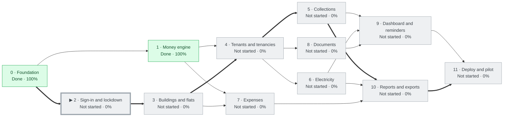

# Family Property Manager — build tracker

> Generated from `tracker.json` by `npm run tracker`. **Do not edit this file by hand.**
> Visual version: [tracker.html](tracker.html) · History: [CHANGELOG.md](CHANGELOG.md)

**Last updated:** 2026-11-19 21:30 IST  
**Overall progress:** `█████░░░░░░░░░░░░░░░` **26%** (19 of 73 tasks done)  
**Open blockers:** 4

## ▶ Where we are now

**Phase 2 · Sign-in and lockdown** — Not started, 0% done

**Current step:** Waiting for owner decisions B2 (sign-in method) and B3 (Blaze plan) before starting Phase 2.

**Comment:** Phase 1 money engine is done and tested. Phase 2 is next on the critical path; nothing else can start before it.

## Next steps

1. Owner decides sign-in method (B2) — Google sign-in recommended.
2. Owner switches the Firebase project to the Blaze plan with a budget alert (B3); needed by Phase 8, can be done any time before.
3. Start Phase 2: Firebase Auth, family allowlist with roles, Firestore rules and emulator tests.

## Flowchart

Thick arrows = critical path · ▶ = current phase · ⚠ = needs re-check after an upstream change.

## Phases

| # | Phase | Status | Progress | Depends on | Unlocks | Comment |
|---|---|---|---|---|---|---|
| 0 | Foundation | ✔ Done | 100% (7/7) | — | 1, 2, 11 | Lint, build and browser check (desktop and phone sizes) passed on 2026-11-19. |
| 1 | Money engine | ✔ Done | 100% (12/12) | 0 | 4, 5, 6, 7, 11 | 61 tests passing (npm test). Logic only: Firestore wiring and screens come in Phases 4-7 and 10. |
| 2 | **▶ Sign-in and lockdown** | ○ Not started | 0% (0/7) | 0 | 3, 8, 11 | Needs decision B2 (sign-in method) before starting. |
| 3 | Buildings and flats | ○ Not started | 0% (0/6) | 2 | 4, 6, 7, 11 |  |
| 4 | Tenants and tenancies | ○ Not started | 0% (0/6) | 1, 3 | 5, 6, 8, 11 |  |
| 5 | Collections | ○ Not started | 0% (0/8) | 1, 4 | 9, 10, 11 |  |
| 6 | Electricity | ○ Not started | 0% (0/4) | 1, 3, 4 | 9, 10, 11 | Manual entry only in version 1. |
| 7 | Expenses | ○ Not started | 0% (0/4) | 1, 3 | 10, 11 |  |
| 8 | Documents | ○ Not started | 0% (0/4) | 2, 4 | 9, 11 | Firebase Storage needs the Blaze plan (blocker B3). |
| 9 | Dashboard and reminders | ○ Not started | 0% (0/4) | 5, 6, 8 | 11 |  |
| 10 | Reports and exports | ○ Not started | 0% (0/5) | 5, 6, 7 | 11 |  |
| 11 | Deploy and pilot | ○ Not started | 0% (0/6) | 0, 1, 2, 3, 4, 5, 6, 7, 8, 9, 10 | — |  |

## Open decisions and blockers

| ID | Decision / blocker | Blocks | Status | Comment |
|---|---|---|---|---|
| B1 | Git author name and email not set | Task 0.7 | Resolved | Owner to run git config user.name / user.email, or tell Claude the values. |
| B2 | Sign-in method: Google (recommended) or email + password | Phase 2, Task 2.1 | Open |  |
| B3 | Firebase Blaze plan with budget alert | Phase 8 | Open | Required for Firebase Storage on new projects; expected cost ₹0 at family scale. |
| B4 | Reminders: push notifications or in-app only | Task 9.4 | Open | In-app reminders work either way. |
| B5 | Real flat inventory, tenants and opening balances | Task 11.4 | Open | Entered through the app during the pilot, never committed. |

## Acceptance scenarios

Each scenario is proven twice: an automated logic test, then a check in the real app.

| # | Scenario | Logic test | App check |
|---|---|---|---|
| 1 | Full rent quick action saves the exact remaining amount once | ✔ Done (Phase 1) | ○ Not started (Phase 5) |
| 2 | Partial payment keeps the remainder on its original period | ✔ Done (Phase 1) | ○ Not started (Phase 5) |
| 3 | Missed periods paid oldest first; credit visible | ✔ Done (Phase 1) | ○ Not started (Phase 5) |
| 4 | 31st anniversary through February, incl. leap years | ✔ Done (Phase 1) | ○ Not started (Phase 4) |
| 5 | Mid-period departure proration with explicit correction | ✔ Done (Phase 1) | ○ Not started (Phase 4) |
| 6 | Replacement tenant inherits no debt; history kept | ✔ Done (Phase 1) | ○ Not started (Phase 4) |
| 7 | Submeter readings exact; reset and override rules | ✔ Done (Phase 1) | ○ Not started (Phase 6) |
| 8 | Building expense split incl. vacant flats, stable after new flat | ✔ Done (Phase 1) | ○ Not started (Phase 7) |
| 9 | Both payer types reduce primary profit; cash surplus correct | ✔ Done (Phase 1) | ○ Not started (Phase 10) |
| 10 | Electricity states (unpaid, no bill, unknown, failed) distinct | ○ Not started (Phase 6) | ○ Not started (Phase 6) |
| 11 | Openings, history and generated charges never double-count | ✔ Done (Phase 1) | ○ Not started (Phase 4) |
| 12 | Permissions, audit, recoverable delete, private documents, exports | ○ Not started (Phase 2) | ○ Not started (Phase 11) |

## Phase details

### Phase 0 · Foundation — Done (100%)

**Outcome:** Git repo, app shell, navigation, requirements and plan docs.  
**Depends on:** —  
**Unlocks:** 1 · Money engine, 2 · Sign-in and lockdown, 11 · Deploy and pilot
  
**Comment:** Lint, build and browser check (desktop and phone sizes) passed on 2026-11-19.

| Task | Description | Status | Comment |
|---|---|---|---|
| 0.1 | Carry over requirements from the Family Rent handoff (docs/REQUIREMENTS.md) | ✔ Done |  |
| 0.2 | Roadmap and architecture notes (docs/ROADMAP.md) | ✔ Done |  |
| 0.3 | Rewrite AGENTS.md and README.md for React + Firebase | ✔ Done |  |
| 0.4 | Initialise git repository and confirm .gitignore | ✔ Done | .env.local, node_modules and dist are ignored. |
| 0.5 | App shell: routing, sidebar, phone bottom bar, placeholder pages | ✔✔ Verified | Checked in the browser at desktop and 375px phone width; no console errors. |
| 0.6 | Build progress tracker (this document) with change log | ✔ Done |  |
| 0.7 | First git commit | ✔ Done | Commit 17736d8 "project started". |

### Phase 1 · Money engine — Done (100%)

**Outcome:** Pure JavaScript functions for every money rule, with automated tests. No Firebase.  
**Depends on:** 0 · Foundation  
**Unlocks:** 4 · Tenants and tenancies, 5 · Collections, 6 · Electricity, 7 · Expenses, 11 · Deploy and pilot
  
**Comment:** 61 tests passing (npm test). Logic only: Firestore wiring and screens come in Phases 4-7 and 10.

| Task | Description | Status | Comment |
|---|---|---|---|
| 1.1 | Add Vitest test runner | ✔ Done | Vitest 5.1; npm test. |
| 1.2 | Money helpers: integer paise, ₹ Indian formatting, half-up rounding | ✔ Done | src/lib/money/money.js |
| 1.3 | Asia/Kolkata business date helpers | ✔ Done | src/lib/money/dates.js |
| 1.4 | Anniversary rent periods incl. 29/30/31 clamping and leap years | ✔ Done | src/lib/money/rent.js |
| 1.5 | Departure proration (leaving day included, half-up) | ✔ Done | departurePreview / departureCharges; also flags a leaving period covered by an opening for manual review (handoff concern #2). |
| 1.6 | Payment allocation: oldest first, credit, manual reallocation | ✔ Done | src/lib/money/allocation.js; payment preview warns when older debt is paid first. |
| 1.7 | Adjustments target their own period (handoff concern #1) | ✔ Done | Fixed: corrections/reversals reduce their own period first. Mutation check confirmed the tests catch the old behaviour. |
| 1.8 | Building expense split incl. vacant flats, exact paise | ✔ Done | src/lib/money/expenses.js |
| 1.9 | Primary profit and owner cash surplus formulas | ✔ Done | src/lib/money/reports.js |
| 1.10 | Expected rent split across calendar years to the paisa | ✔ Done | expectedRentInRange; departure across year end tested. |
| 1.11 | Openings never double-count with generated charges | ✔ Done | openingCharge shares the period ID with generated rent. |
| 1.12 | Submeter consumption with exact arithmetic, reset and override | ✔ Done | Exact BigInt arithmetic, so the preview equals the saved amount (handoff concern #6). |

### ▶ Phase 2 · Sign-in and lockdown — Not started (0%)

**Outcome:** Family-only sign-in with admin/family roles enforced by Firestore rules.  
**Depends on:** 0 · Foundation  
**Unlocks:** 3 · Buildings and flats, 8 · Documents, 11 · Deploy and pilot
  
**Blocked by:** B2 (Sign-in method: Google (recommended) or email + password)
  
**Comment:** Needs decision B2 (sign-in method) before starting.

| Task | Description | Status | Comment |
|---|---|---|---|
| 2.1 | Confirm sign-in method (Google recommended) | ○ Not started | Blocker B2. |
| 2.2 | Firebase Auth sign-in and sign-out | ○ Not started |  |
| 2.3 | Allowlist with admin/family roles | ○ Not started |  |
| 2.4 | Route guard and 'not authorised' page | ○ Not started |  |
| 2.5 | Firestore security rules | ○ Not started |  |
| 2.6 | Rules tests in the Firebase emulator | ○ Not started |  |
| 2.7 | Audit log helper; append-only rule | ○ Not started |  |

### Phase 3 · Buildings and flats — Not started (0%)

**Outcome:** Building → floor → flat setup with derived occupancy.  
**Depends on:** 2 · Sign-in and lockdown  
**Unlocks:** 4 · Tenants and tenancies, 6 · Electricity, 7 · Expenses, 11 · Deploy and pilot

| Task | Description | Status | Comment |
|---|---|---|---|
| 3.1 | Buildings: add/edit (admin only) | ○ Not started |  |
| 3.2 | Create the five initial buildings through the app | ○ Not started | Not as committed seed data. |
| 3.3 | Flats: floor, position, friendly name, CA numbers | ○ Not started |  |
| 3.4 | Reject duplicate floor + position in a building | ○ Not started |  |
| 3.5 | Occupancy derived from tenancy dates | ○ Not started |  |
| 3.6 | Hierarchy view and search | ○ Not started |  |

### Phase 4 · Tenants and tenancies — Not started (0%)

**Outcome:** Tenant records, move-in, departure with proration preview, history.  
**Depends on:** 1 · Money engine, 3 · Buildings and flats  
**Unlocks:** 5 · Collections, 6 · Electricity, 8 · Documents, 11 · Deploy and pilot

| Task | Description | Status | Comment |
|---|---|---|---|
| 4.1 | Tenant records: contacts, household, vehicles, notes | ○ Not started |  |
| 4.2 | Mask phone and ID numbers in lists | ○ Not started |  |
| 4.3 | Start tenancy with overlap check (transaction) | ○ Not started |  |
| 4.4 | Departure: proration preview and explicit adjustment | ○ Not started |  |
| 4.5 | Opening balances with first-period preview | ○ Not started | Handoff concern #2. |
| 4.6 | Tenancy history per flat | ○ Not started |  |

### Phase 5 · Collections — Not started (0%)

**Outcome:** Fast monthly rent collection with transparent allocation and credit.  
**Depends on:** 1 · Money engine, 4 · Tenants and tenancies  
**Unlocks:** 9 · Dashboard and reminders, 10 · Reports and exports, 11 · Deploy and pilot

| Task | Description | Status | Comment |
|---|---|---|---|
| 5.1 | Charge generation with deterministic IDs (no duplicates) | ○ Not started |  |
| 5.2 | Collections list for the month | ○ Not started |  |
| 5.3 | Quick 'full rent received' action | ○ Not started |  |
| 5.4 | Partial payment entry | ○ Not started |  |
| 5.5 | Allocation preview and manual reallocation | ○ Not started |  |
| 5.6 | Safe retries (no duplicate payment) | ○ Not started | Handoff concern #5. |
| 5.7 | Stale-edit protection with versions | ○ Not started |  |
| 5.8 | Tenancy ledger view | ○ Not started |  |

### Phase 6 · Electricity — Not started (0%)

**Outcome:** Own-meter bills and shared-meter submeter charges, kept separate from rent.  
**Depends on:** 1 · Money engine, 3 · Buildings and flats, 4 · Tenants and tenancies  
**Unlocks:** 9 · Dashboard and reminders, 10 · Reports and exports, 11 · Deploy and pilot
  
**Comment:** Manual entry only in version 1.

| Task | Description | Status | Comment |
|---|---|---|---|
| 6.1 | Connections: own meter (CA) and shared main + submeters | ○ Not started |  |
| 6.2 | Own-meter bills with distinct statuses | ○ Not started |  |
| 6.3 | Submeter readings, reset and override with reason | ○ Not started |  |
| 6.4 | Electricity account separate from rent | ○ Not started |  |

### Phase 7 · Expenses — Not started (0%)

**Outcome:** Expenses by building or flat, payer type, stored building split.  
**Depends on:** 1 · Money engine, 3 · Buildings and flats  
**Unlocks:** 10 · Reports and exports, 11 · Deploy and pilot

| Task | Description | Status | Comment |
|---|---|---|---|
| 7.1 | Editable categories (add, rename, archive) | ○ Not started |  |
| 7.2 | Expense entry with payer type and evidence | ○ Not started |  |
| 7.3 | Store building split snapshot at posting | ○ Not started |  |
| 7.4 | Expense list and filters | ○ Not started |  |

### Phase 8 · Documents — Not started (0%)

**Outcome:** Private agreements, IDs, bills and receipts attached to their records.  
**Depends on:** 2 · Sign-in and lockdown, 4 · Tenants and tenancies  
**Unlocks:** 9 · Dashboard and reminders, 11 · Deploy and pilot
  
**Blocked by:** B3 (Firebase Blaze plan with budget alert)
  
**Comment:** Firebase Storage needs the Blaze plan (blocker B3).

| Task | Description | Status | Comment |
|---|---|---|---|
| 8.1 | Storage security rules | ○ Not started |  |
| 8.2 | Upload: camera, PDF, JPEG, PNG up to 15 MB | ○ Not started |  |
| 8.3 | Attach documents to their original record | ○ Not started |  |
| 8.4 | Authenticated preview and download | ○ Not started |  |

### Phase 9 · Dashboard and reminders — Not started (0%)

**Outcome:** Home screen with overdue rent, bills due, expiring agreements and tasks.  
**Depends on:** 5 · Collections, 6 · Electricity, 8 · Documents  
**Unlocks:** 11 · Deploy and pilot
  
**Blocked by:** B4 (Reminders: push notifications or in-app only)

| Task | Description | Status | Comment |
|---|---|---|---|
| 9.1 | Computed reminders: rent, agreement 30/7 days, electricity | ○ Not started |  |
| 9.2 | Custom reminders | ○ Not started |  |
| 9.3 | Dashboard summary | ○ Not started |  |
| 9.4 | Decide push notifications vs in-app only | ○ Not started | Blocker B4. |

### Phase 10 · Reports and exports — Not started (0%)

**Outcome:** Rent, electricity, expense, profit and occupancy reports with Excel/PDF export.  
**Depends on:** 5 · Collections, 6 · Electricity, 7 · Expenses  
**Unlocks:** 11 · Deploy and pilot

| Task | Description | Status | Comment |
|---|---|---|---|
| 10.1 | Report calculations on agreed bases | ○ Not started |  |
| 10.2 | Filters: building, flat, tenant, dates | ○ Not started |  |
| 10.3 | Gross debt and credit shown separately from net | ○ Not started | Handoff concern #3. |
| 10.4 | Excel export | ○ Not started |  |
| 10.5 | PDF export with full Unicode names | ○ Not started |  |

### Phase 11 · Deploy and pilot — Not started (0%)

**Outcome:** Live on Firebase Hosting, installed on family phones, backups proven, pilot accepted.  
**Depends on:** 0 · Foundation, 1 · Money engine, 2 · Sign-in and lockdown, 3 · Buildings and flats, 4 · Tenants and tenancies, 5 · Collections, 6 · Electricity, 7 · Expenses, 8 · Documents, 9 · Dashboard and reminders, 10 · Reports and exports  
**Unlocks:** —
  
**Blocked by:** B5 (Real flat inventory, tenants and opening balances)

| Task | Description | Status | Comment |
|---|---|---|---|
| 11.1 | Firebase Hosting deploy | ○ Not started |  |
| 11.2 | PNG app icons and offline service worker | ○ Not started |  |
| 11.3 | Backup export and restore drill | ○ Not started |  |
| 11.4 | Enter real setup data through the app | ○ Not started | Blocker B5. |
| 11.5 | Family pilot on two or more devices | ○ Not started |  |
| 11.6 | Run all 12 acceptance scenarios in the app | ○ Not started |  |

## How to update

1. Edit `docs/tracker/tracker.json` (statuses, comments, current step, next steps, blockers).
2. Run `node scripts/build-tracker.js --log "What changed" --why "Reason" --phases <changed phase ids>`.
3. Review any phase flagged ⚠ Needs re-check; set its `needsRecheck` back to `false` once reviewed, and log that too.
4. Commit `tracker.json`, `TRACKER.md`, `tracker.html` and `CHANGELOG.md` together.
